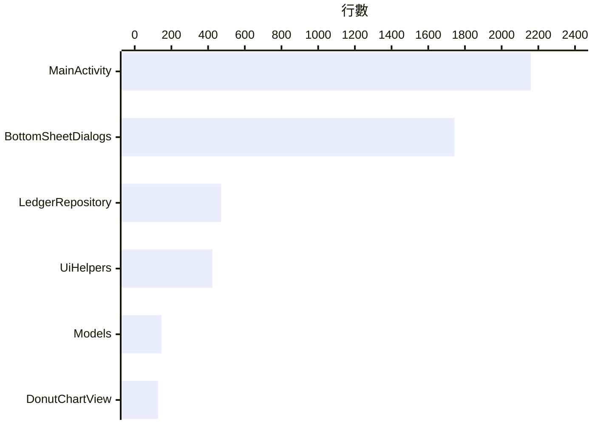

# 快樂記帳本（Mymoney）的程式碼架構健康嗎？ {#mymoney-health}

套件依賴呈**單向無環結構**，但 `77.0%` 程式碼集中在兩個巨型視圖檔，且介面層直接改寫可變資料集合。

- 四個套件沿 `MainActivity` 指向 `ui`、`data`、`model`，全庫 `0` 個循環依賴。
- `MainActivity.kt`（`2,159` 行）與 `BottomSheetDialogs.kt`（`1,743` 行）合佔 `5,069` 行的 `77.0%`。
- 介面層有 `29` 處直接存取 `repo.data`，刪除舊帳戶後會令首頁與帳戶頁的淨資產總額不一致。
- 全庫目前為 `0` 個自動化測試檔，拆分大型畫面元件前缺乏回歸保護網。

@answer scope="Mymoney 5b9ed0f · 6 個 Kotlin 檔共 5,069 行"
@meta locale=zh-TW style=editorial
@source repo-main title="MainActivity 狀態欄位與全量渲染入口" path=app/src/main/java/com/example/mymoney/MainActivity.kt lines=57:175
@source render-all title="MainActivity.renderAll 與首頁淨資產彙算" path=app/src/main/java/com/example/mymoney/MainActivity.kt lines=1423:1536
@source acc-tab title="MainActivity.renderAccountsTab 帳戶頁淨資產計算" path=app/src/main/java/com/example/mymoney/MainActivity.kt lines=1947:1961
@source sheet-tx title="BottomSheetDialogs.showTransactionSheet 記帳抽屜" path=app/src/main/java/com/example/mymoney/ui/BottomSheetDialogs.kt lines=218:292
@source delete-acc title="BottomSheetDialogs.showAccountSheet 刪除帳戶邏輯" path=app/src/main/java/com/example/mymoney/ui/BottomSheetDialogs.kt lines=895:925
@source widgets-ui title="DonutChartView 圓環統計圖元件" path=app/src/main/java/com/example/mymoney/ui/DonutChartView.kt lines=21:58
@source calc-expr title="UiHelpers.evaluateCalcExpression 四則運算解析器" path=app/src/main/java/com/example/mymoney/ui/UiHelpers.kt lines=166:236
@source balance-calc title="LedgerRepository.computeAccountBalances 餘額計算" path=app/src/main/java/com/example/mymoney/data/LedgerRepository.kt lines=79:99
@source models-data title="Models.AppData 可變集合資料模型" path=app/src/main/java/com/example/mymoney/model/Models.kt lines=62:83

## 模組依賴與耦合邊界長什麼樣？ {#dependency-topology}

@architecture id=module-map title="Mymoney 套件與檔案依賴拓撲"
| role frontend | 主畫面控制器 |
| role backend | 互動視圖元件 |
| role database | 資料存取層 |
| role security | 領域模型層 |
| main_act | MainActivity | frontend | source:repo-main |
| sheets | BottomSheetDialogs | backend | source:sheet-tx |
| widgets | UiHelpers 與圓環圖 | backend | source:widgets-ui |
| ledger_repo | LedgerRepository | database | source:balance-calc |
| models | Models | security | source:models-data |
| main_act > sheets | 開啟六種抽屜 |
| main_act > widgets | 繪製圖表與對話框 |
| main_act > ledger_repo | 讀寫帳本與匯出入 | emphasis |
| sheets > ledger_repo | 直接改寫集合 | emphasis |
| sheets > widgets | 共用排版與算式 |
| ledger_repo > models | 轉換 JSON 實體 |
| main_act > models | 讀取列舉常數 | dashed |
| sheets > models | 建立交易與帳戶 | dashed |

@steps id=topology-steps
| step-main | MainActivity | 掌管四大分頁、月份切換與系統檔案匯出入，無任何下層模組反向匯入它。 | module-map | main_act |
| step-sheets | BottomSheetDialogs | 承載記帳、預算、帳戶、週期與分類抽屜，以回呼函式通知畫面刷新，避開雙向耦合。 | module-map | sheets |
| step-widgets | UiHelpers 與圓環圖 | 提供 `DonutChartView`、`WrapLayout` 與四則運算解析，對業務資料零依賴。 | module-map | widgets |
| step-repo | LedgerRepository | 封裝 `SharedPreferences` 讀寫、餘額彙算與 CSV 解析，未混入任何視圖類別。 | module-map | ledger_repo |
| step-models | Models | 定義交易、帳戶、分類結構與預設色票，位於依賴鏈最底層。 | module-map | models |

## 程式碼規模與複雜度集中在哪裡？ {#concentration-hotspots}

全庫 `6` 個 Kotlin 檔案共 `5,069` 行（扣除空行與註解為 `4,560` 行）。前兩大檔案合計 `3,902` 行（`2,159 + 1,743 = 3,902`，佔 `77.0%`），雙雙超過單檔 `1,500` 行的集中度警戒值。

| 檔案或熱點函式 | 實測規模 | 架構診斷訊號 |
| --- | --- | --- |
| `MainActivity.kt` | `2,159` 行（佔 `42.6%`） | 含 `36` 個函式與逾 `35` 個 `lateinit` 視圖欄位 {bad:高度集中} |
| `showTransactionSheet` | `551` 行 · 分支點 `57` | 單一函式內嵌計算機、分類網格與轉帳表單閉包 {bad:複雜度最高} |
| `renderLedgerTab` | `267` 行 · 分支點 `24` | 每次狀態變更清空容器並重建整月明細視圖樹 {caution:全量重繪} |
| `showCategorySheet` | `301` 行 · 巢狀深度 `8` | 標籤渲染、保護檢查與新增編輯表單寫在同一閉包 {caution:深層巢狀} |
| `LedgerRepository.kt` | `471` 行（佔 `9.3%`） | 職責聚焦於 JSON 轉換、CSV 解析與餘額計算 {good:邊界清晰} |
| `UiHelpers` 與 `Models` | 合佔 `569` 行（`11.2%`） | 純工具函式與資料結構，零業務反向耦合 {good:容易測試} |

## 為什麼直接改寫 repo.data 會讓淨資產算錯？ {#encapsulation-leak}

`AppData` 將 `accounts`、`transactions` 等集合宣告為公開 `MutableList`。`MainActivity.kt`（`15` 處）與 `BottomSheetDialogs.kt`（`14` 處）共有 `29` 處直接讀寫 `repo.data`，繞過 `LedgerRepository` 的一致性檢查。

當使用者在 `showAccountSheet` 刪除曾有交易紀錄的帳戶時，程式碼僅從 `repo.data.accounts` 移除該帳戶，卻保留關聯的歷史交易：

@code source=delete-acc language=kotlin

接著 `computeAccountBalances` 走訪歷史交易時，會把已刪除帳戶的 `tx.accountId` 重新寫回回傳的 `Map`，且轉帳轉入端因 `map.containsKey(dest)` 為假而漏計入帳金額：

@code source=balance-calc language=kotlin

這導致明細首頁以 `balances.values.sum()` 加總全部鍵值（含孤兒帳戶差額），而帳戶分頁僅走訪 `repo.data.accounts` 累加現存帳戶，兩頁顯示的總淨資產隨即出現落差。此外，週期收支在介面允許輸入每月 `1` 至 `31` 日，但 `applyPendingRecurring` 卻強制截斷為 `1` 至 `28` 日，規則分散在兩層。

## 建議依什麼順序安全重構？ {#refactoring-roadmap}

@workflow id=refactor-plan title="四階段漸進重構路線"
| role frontend | 測試護欄 |
| role database | 資料封裝 |
| role backend | 視圖拆分 |
| tests | 補齊核心單元測試 | frontend |
| repo_api | 收斂 Repository 寫入介面 | database |
| split_sheets | 拆解六個獨立抽屜類別 | backend |
| split_tabs | 拆出四大分頁視圖控制器 | backend |
| tests > repo_api | 鎖定餘額與算式 | emphasis |
| repo_api > split_sheets | 消除直接改寫 | emphasis |
| split_sheets > split_tabs | 降低單檔行數 |

@callout level=note title="分析工具涵蓋範圍說明"
| Archify 內建 `code-analysis prepare` 實測耗時約 `3` 秒，因目前僅支援 `ts`、`py`、`java`、`go`、`rust`、`c`、`cpp` 解析器，對純 Kotlin 專案回傳 `extract/adapter-undetected`。本報告改由靜態掃描全庫 `6` 個 `.kt` 原始檔並對照 Git 提交 `5b9ed0f` 實測產出；靜態複雜度與集中度屬於維護性訊號，不等同執行期錯誤。 |

- [ ] 為 `evaluateCalcExpression`、`computeAccountBalances` 與 `parseCsvTransactions` 建立首批 JVM 單元測試（位於 `app/src/test/`）。
- [ ] 將 `AppData` 集合改為唯讀 `List`，在 `LedgerRepository` 新增 `deleteAccount`（拒絕刪除仍有關聯交易的帳戶，或同步遷移交易）並消除 `29` 處外部 `repo.data` 直接變更。
- [ ] 統一固定週期入帳日上限規則（明確採用每月 `28` 日或依大小月動態對齊月底），避免設定介面與入帳結果不符。
- [ ] 將 `BottomSheetDialogs.kt` 依職責拆分為 `TransactionSheet`、`CategorySheet`、`RecurringSheet` 等獨立檔案，使單檔降至 `600` 行內。
- [ ] 將 `MainActivity.kt` 的四個分頁渲染邏輯獨立為專屬頁面元件，保留 `MainActivity` 負責導覽列與 SAF 系統回呼。
